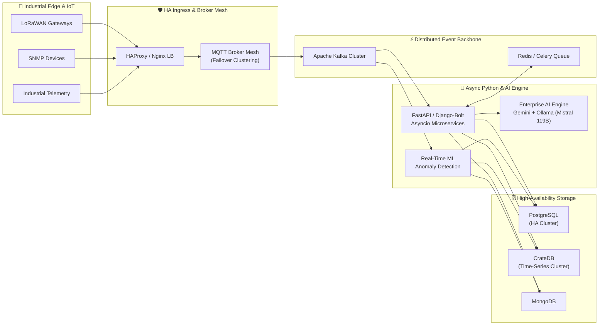

<div align="center">

  

  <br/>

  <!-- Dynamic Typing Telemetry -->
  <a href="https://github.com/MiqueasAguirreANX">
    
  </a>

  <p align="center">
    <a href="https://www.linkedin.com/in/miqueas-aguirre-621511167">
      
    </a>
    <a href="mailto:miqueasburzum@gmail.com">
      
    </a>
    
    
  </p>

</div>

---

### 🖥️ `whoami` // System Specification

```yaml
miqueas@arch-cluster-01:~$ cat /etc/architect/spec.yaml
---
identity:
  name: "Miqueas Aguirre"
  role: "Backend Lead & Python Architect | Infrastructure & AI Engineer"
  experience: "5+ years designing mission-critical, high-availability systems"
  foundation: "Electronic Engineering background (UTN) -> hardware-to-cloud systems mindset"

core_capabilities:
  high_availability:
    - "Zero-downtime failover clusters (PostgreSQL HA, CrateDB, Apache Kafka)"
    - "Distributed MQTT Broker Mesh orchestration for resilient telemetry ingestion"
    - "Load balancing & reverse-proxy hardening (HAProxy, Nginx, Docker, Kubernetes)"
  backend_architecture:
    - "High-throughput async Python services (FastAPI, Django, Django-Bolt, Asyncio, Celery)"
    - "Multi-tenant SaaS architectures, FinTech payment integrations & cybersecurity MVPs"
  industrial_iot:
    - "Large-scale real-time telemetry ingestion via MQTT, Paho-MQTT, LoRaWAN & SNMP"
  enterprise_ai:
    - "Real-time statistical & ML anomaly detection for multi-tenant IoT data streams"
    - "Generative AI pipelines with Google Gemini & Local LLMs (Mistral 119B via Ollama)"
    - "AI-native engineering workflows (Cursor) for autonomous & accelerated delivery"

off_duty_processes:
  - "🎸 Dialing in heavy metal riffs on electric guitar"
  - "🛡️ Defending towers in Kingdom Rush"
  - "🐧 Daily-driving & tuning Linux Mint"
```

---

### 🏗️ Reference Architecture // What I Build in Production

> A snapshot of the distributed, fault-tolerant ecosystems I design and lead—bridging **industrial edge telemetry**, **high-availability broker meshes**, **async Python microservices**, and **real-time AI/ML inference**:



---

### 🧠 Core Technical Arsenal

<table>
  <thead>
    <tr>
      <th width="26%">Domain</th>
      <th width="74%">Stack & Production Capabilities</th>
    </tr>
  </thead>
  <tbody>
    <tr>
      <td><b>🐍 Backend & Async Python</b></td>
      <td>
        
        
        
        
        
        
        
        <br/>
        <sub>Multi-tenant SaaS architectures • High-concurrency microservices • Event-driven workers • REST & real-time APIs</sub>
      </td>
    </tr>
    <tr>
      <td><b>🛡️ Architecture & HA Infra</b></td>
      <td>
        
        
        
        
        
        
        <br/>
        <sub>High Availability (HA) clustering • Automated failover node management • Container orchestration • Zero-downtime deployments</sub>
      </td>
    </tr>
    <tr>
      <td><b>🗄️ Distributed Data & Brokers</b></td>
      <td>
        
        
        
        
        
        
        <br/>
        <sub>Replicated PostgreSQL clusters • Distributed CrateDB time-series storage • Kafka event streaming • Fault-tolerant MQTT Broker Mesh</sub>
      </td>
    </tr>
    <tr>
      <td><b>🤖 Enterprise AI & ML</b></td>
      <td>
        
        
        
        
        
        <br/>
        <sub>Real-time statistical & ML anomaly detection • On-prem Local LLM inference (Mistral 119B via Ollama) • Autonomous GenAI pipelines</sub>
      </td>
    </tr>
    <tr>
      <td><b>📡 Industrial IoT & Protocols</b></td>
      <td>
        
        
        
        
        <br/>
        <sub>High-throughput industrial device ingestion • Low-latency telemetry parsing • Multi-protocol edge-to-cloud bridges</sub>
      </td>
    </tr>
    <tr>
      <td><b>⚛️ Frontend & Integrations</b></td>
      <td>
        
        
        
        <br/>
        <sub>Fullstack SPA dashboards • Regional payment gateways & taxation workflows • European market & global crypto analytics</sub>
      </td>
    </tr>
  </tbody>
</table>

---

### 📜 Production Track Record // `git log --career`

```
* commit HEAD -> main (2023.09 - PRESENT)
│ Role:   Backend Lead & Infrastructure Engineer @ Daitek (Buenos Aires)
│ Impact: • Architected & deployed mission-critical HA infrastructure (PostgreSQL HA, CrateDB & Kafka clusters).
│         • Orchestrated a fault-tolerant mesh network of MQTT brokers with automated failover node management.
│         • Built large-scale real-time industrial telemetry ingestion engines (MQTT, LoRaWAN, SNMP).
│         • Designed a real-time ML & statistical anomaly detection microservice for multi-tenant IoT streams.
│         • Directed R&D and core backend optimization across FastAPI, Django, Django-Bolt & Asyncio services.
│
* commit a8f42c1 (2021.05 - 2023.08)
│ Role:   Fullstack Developer @ Kensa (Saudi Arabia · Remote)
│ Impact: • Delivered rapid end-to-end Cyber Security MVPs under tight commercial launch deadlines.
│         • Engineered scalable fullstack architectures (Django/DRF, Flask, React.js), bridging legacy systems
│           into modern microservices and optimizing high-volume security event log parsing.
│         • Automated CI/CD delivery pipelines, custom data-processing scripts, and distributed scrapers.
│
* commit 7d91e04 (2020.06 - PRESENT)
│ Role:   Software Engineer & SaaS Architect @ Independent Consultant (Remote)
│ Impact: • Architected multi-tenant SaaS platforms: reservation systems, cybersecurity suites, and a complete
│           end-to-end Pharmacy Management Platform (inventory, staff, billing & receipt lifecycle).
│         • Integrated regional payment gateways & tax engines (Mercado Pago) and built analytics pipelines
│           for European market datasets and global Crypto projects.
│         • Spearheaded enterprise GenAI workflows with Google Gemini, Local LLMs (Ollama), and Cursor.
│
* commit 1b00f99 (2018 - 2021)
  Foundation: Electronic Engineering (Level 2 Foundation) @ UTN - Facultad Regional Haedo
  Focus:      Algorithms & Data Structures, Advanced Calculus & Linear Algebra, Electromagnetism, Digital Logic.
```

---

### 📊 GitHub Telemetry

<div align="center">
  
  
</div>

---

<div align="center">
  <sub>
    <code>[STATUS: READY FOR COMPLEX ARCHITECTURE CHALLENGES]</code> •
    Built with 🐍 Python mindset, 🐧 Linux Mint &amp; 🎸 Heavy Metal by <b>Miqueas Aguirre</b>
  </sub>
</div>
